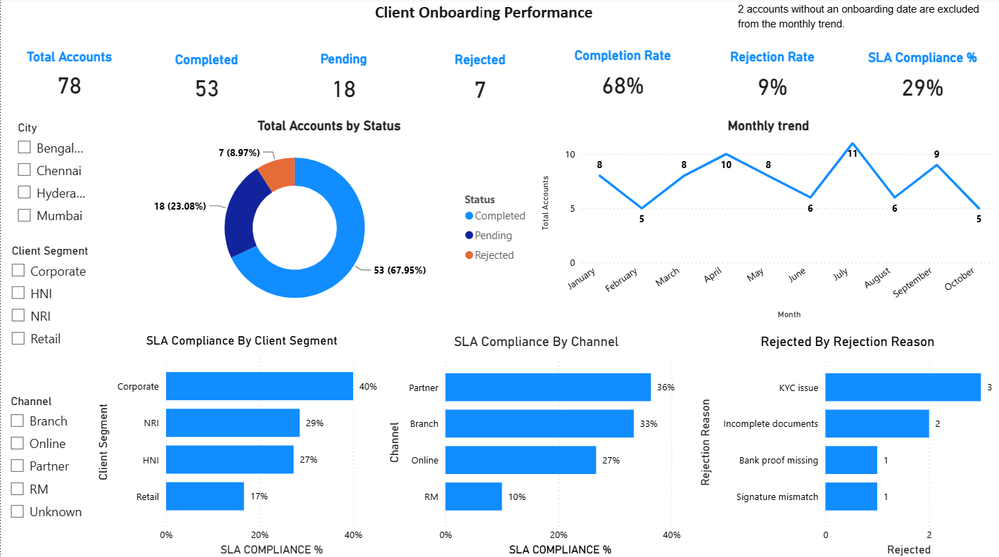

Client Onboarding Analytics

Excel data cleaning and a Power BI dashboard on client onboarding performance (practice dataset).

**Tools:** Excel, Power BI

**Key findings**
- 68% of accounts completed, 9% rejected
- Only 29% of completed accounts met the 3-day SLA
- RM channel (10%) and Retail segment (17%) had the weakest SLA performance
- KYC issues were the top rejection reason (3 of 7)
  
Full write-up: see the Findings document in this repository.

